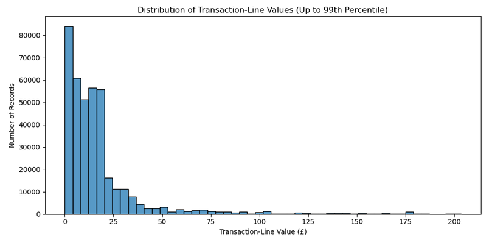
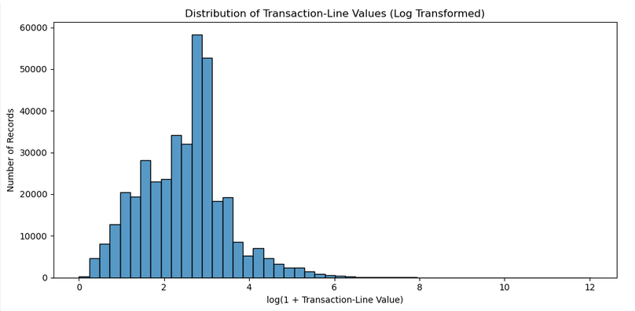
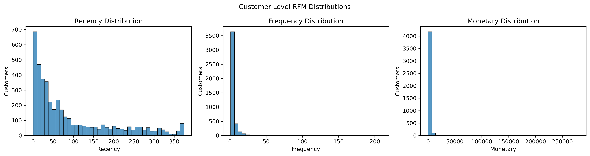
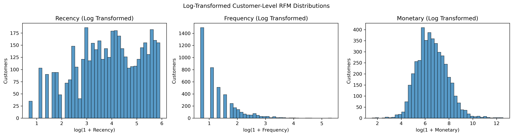
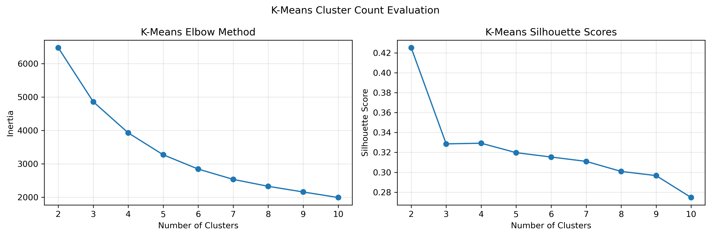
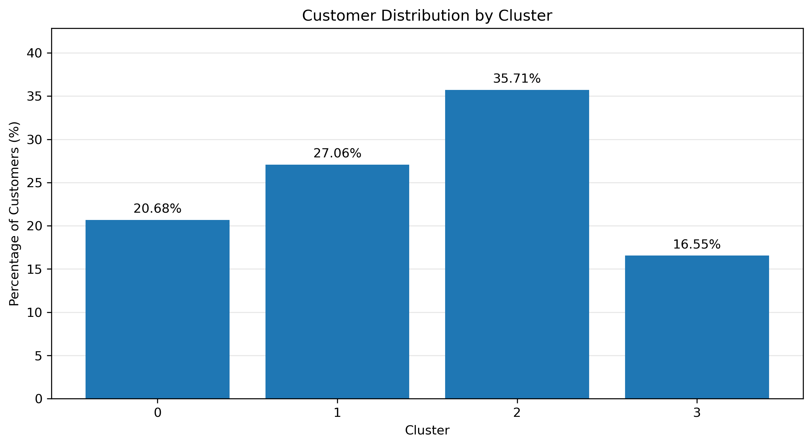
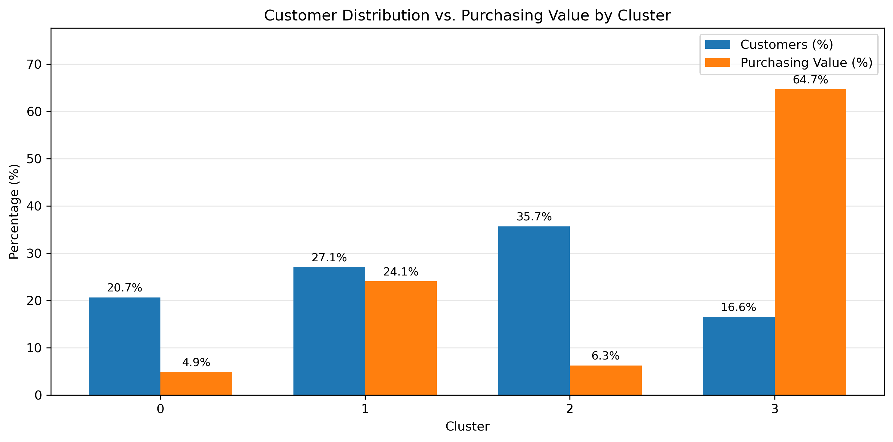

# Customer Segmentation Using Clustering

**Jupyter Notebook:** [Customer Segmentation Clustering Analysis](notebooks/Customer_Segmentation_Clustering.ipynb)

## Project Overview

This project examines customer purchasing behavior using transaction data from the UCI Online Retail dataset. The objective is to identify groups of customers with similar purchasing characteristics using Recency, Frequency, and Monetary (RFM) analysis and K-Means clustering.

Customer segmentation can help businesses better understand purchasing patterns and identify opportunities for targeted marketing, customer retention, and customer engagement.

## Research Question

Can customer purchasing patterns be used to identify meaningful customer segments through RFM analysis and K-Means clustering?

## Dataset

**Source:** [UCI Machine Learning Repository – Online Retail](https://archive.ics.uci.edu/dataset/352/online+retail)

The dataset contains 541,909 transaction records from a UK-based online retail business between December 2010 and December 2011.

The original dataset includes transaction identifiers, product information, quantities, prices, transaction dates, customer identifiers, and customer countries.

The original dataset is not included in this repository. Instructions for obtaining and preparing the data are available in [data/README.md](data/README.md).

## Methodology

The analysis is organized into the following stages:

1. **Data Collection:** Load the original Excel workbook directly from the downloaded ZIP archive.
2. **Data Understanding:** Examine dataset structure, missing values, duplicates, transaction characteristics, and potential data quality issues. 
3. **Data Cleaning:** Remove records without customer identifiers, cancellation transactions, nonpositive quantities or prices, and exact duplicate records.
4. **Exploratory Data Analysis:** Examine transaction values and customer purchasing patterns.
5. **Feature Engineering:** Aggregate transaction records into customer-level Recency, Frequency, and Monetary measures.
6. **Data Processing:** Examine feature distributions, apply logarithmic transformations, and standardize features for clustering.
7. **K-Means Clustering:** Evaluate alternative numbers of clusters and identify customer groups.
8. **Cluster Evaluation:** Assess clustering quality and examine customer characteristics within each segment.
9. **Business Interpretation:** Interpret customer segments and discuss potential business applications.
10. **Conclusions and Future Improvements:** Identify Key Findings, Limitations, and Future Improvements.  

## Data Preparation and Feature Engineering

The data cleaning process reduced the original 541,909 transaction records to 392,692 retained records, representing approximately 72.46% of the original dataset.

The cleaned data contains 4,338 unique customers.

The analysis focuses on positive purchasing activity rather than net spending after returns or cancellations.

Customer-level features were developed using RFM analysis:

- **Recency:** Number of calendar days since the customer's most recent purchase, measured relative to December 10, 2011.
- **Frequency:** Number of distinct purchase invoices associated with the customer.
- **Monetary:** Total value of the customer's retained positive purchases.

The resulting dataset contains one record per customer.

## Feature Transformation and Scaling

The RFM features exhibited different degrees of right-skewness, particularly Frequency and Monetary.

Logarithmic transformations were applied to reduce skewness before standardization.

| Feature | Original Skewness | Log-Transformed Skewness |
|---|---:|---:|
| Recency | 1.25 | -0.33 |
| Frequency | 12.07 | 1.21 |
| Monetary | 19.34 | 0.40 |

The transformed features were standardized using `StandardScaler` to prepare them for K-Means clustering.

Original RFM values were retained for business interpretation.

## Visualizations

The notebook generates visualizations during exploratory analysis and data processing. Figures are displayed within the notebook and saved as PNG files in `outputs/figures/`.

### Transaction Value Distributions





### Customer-Level RFM Distributions





### K-Means Cluster Evaluation



### Customer Segmentation Results

The following visualizations compare the distribution of
customers across the four clusters with their contribution
to total retained positive purchasing value.





Cluster 3 represents 16.55% of customers but accounts for 64.73% of retained positive purchasing value. 
In contrast, Cluster 2 represents 35.71% of customers but contributes only 6.28% of purchasing value.  

## Repository Contents

```text
Customer-Segmentation-Clustering/
├── data/
│   └── README.md
├── notebooks/
│   └── Customer_Segmentation_Clustering.ipynb
├── outputs/
│   └── figures/
│       └── [7 visualization files]
├── .gitignore
├── README.md
└── requirements.txt
```

The original dataset is downloaded separately and stored locally in `data/online+retail.zip`.

## Running the Notebook

1. Clone or download this repository.
2. Install the required Python packages using:

   `pip install -r requirements.txt`

3. Download the Online Retail dataset from the UCI Machine Learning Repository.
4. Place the original ZIP archive in the `data/` directory and name it `online+retail.zip`.
5. Open the notebook in Jupyter and execute it from the `notebooks/` directory, running the cells sequentially.

The notebook loads the Excel workbook directly from the ZIP archive without requiring manual extraction.

Generated figures are saved automatically to `outputs/figures/`.

## Clustering Results

K-Means models containing 2 through 10 clusters were evaluated using inertia and silhouette scores.

The two-cluster model achieved the highest sampled silhouette score (0.4252), indicating the strongest separation among the configurations tested. The elbow method showed decreasing inertia as additional clusters were introduced but did not identify a single definitive cluster count.

Four clusters were selected for the final customer segmentation because they provided more detailed and potentially actionable distinctions in purchasing behavior. The selected model achieved a sampled silhouette score of 0.3292, compared with 0.4252 for the two-cluster model.

The final four-cluster model assigned 4,338 customers to segments based on differences in purchase recency, frequency, and monetary value. The resulting profiles were used to identify potential customer engagement and retention strategies.  

## Business Applications

The resulting customer segments may support business decisions involving:

- Customer retention and re-engagement
- Targeted marketing campaigns
- Identification of frequent and high-value customers
- Development of customer engagement strategies

The analysis identified four customer segments with different purchasing patterns. Potential business applications include encouraging repeat purchases among recent low-spend customers, increasing engagement among moderate-value customers, evaluating re-engagement opportunities for inactive customers, and prioritizing retention efforts for high-value active customers.  

## Limitations

The analysis uses historical transactions from a single online retailer and may not represent customer behavior in other industries or time periods.

Records without customer identifiers and cancellation transactions were excluded, and exact duplicate rows were removed. These decisions affect the purchasing activity represented in the RFM features.

K-Means clustering identifies groups based on similarities in the selected features. The resulting segments should be evaluated for both statistical quality and business usefulness. 

## Portfolio

This project is part of my [Data Science Portfolio](https://github.com/ferrillt/data-science-portfolio).

## References

UCI Machine Learning Repository. (n.d.). *Online Retail* [Data set]. https://archive.ics.uci.edu/dataset/352/online+retail
